<div align="center">


# TerraLens

**Land-cover intelligence from satellite imagery.**

Classify Sentinel-2 tiles, see *why* the model decided, and turn whole scenes into land-cover maps with area statistics, from a web app, a REST API, the command line or a Docker container.

[](https://github.com/Med00amine/TerraLens/actions/workflows/ci.yml)


[](LICENSE)

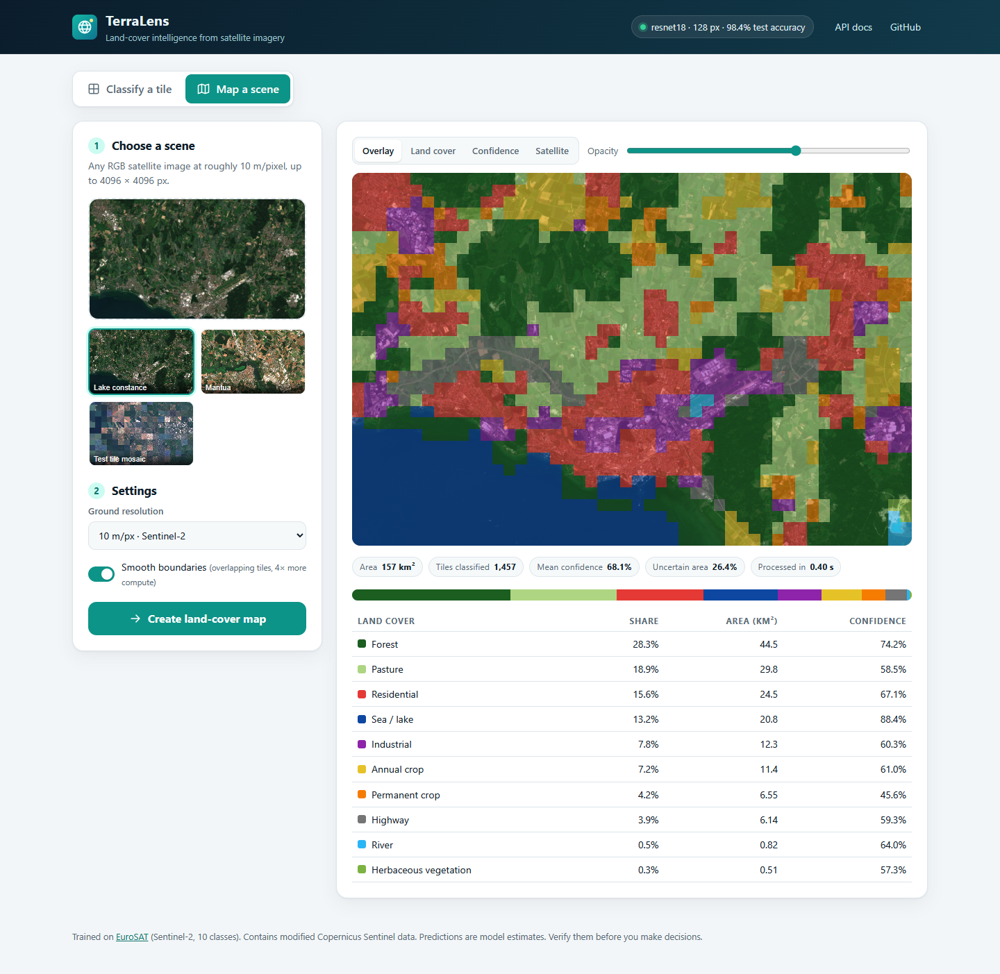

<sub>A real Sentinel-2 scene (Friedrichshafen on Lake Constance, 8 August 2025): 157 km² mapped into 10 land-cover classes in 0.4 s on a GPU, with areas, confidence and the share of uncertain area.</sub>

</div>

---

## Why TerraLens?

Where the forests, farmland, towns and water are, and how that changes, drives decisions in urban planning, agriculture, insurance and conservation. The raw data is free: the Copernicus **Sentinel-2** satellites photograph all land on Earth every ~5 days at 10 m resolution. The missing step is turning those pixels into answers people can use.

| The problem | What TerraLens does |
|---|---|
| Manual land-cover mapping is slow and expensive | Maps a 157 km² scene in 0.4 s on a GPU, ~11 s on a desktop CPU |
| "Black-box" AI is hard to trust | **Grad-CAM** heatmaps show which pixels drove each prediction |
| Over-confident models mislead people | **Calibrated** probabilities (ECE 0.005) plus a confidence map and an "uncertain area" share |
| Benchmark scores hide real-world failure | Model chosen by **external validation** on real scenes in Germany and Italy against ESA WorldCover |
| User uploads are often compressed | Trained to stay accurate on JPEG input: **97.0%** at quality 50, where a standard model drops to 72% |
| ML tools are hard to deploy | One `docker run`, a documented REST API, a CLI and a web UI |

**Who it's for:** urban planners measuring sprawl, NGOs monitoring forest and wetland loss, agronomists and insurers estimating crop area, journalists and researchers who need quick land-use statistics, and students learning remote sensing.

## Features

- **10 land-cover classes:** annual crop, permanent crop, pasture, herbaceous vegetation, forest, river, sea/lake, residential, industrial, highway
- **Tile classification** with calibrated probabilities and a **Grad-CAM** explanation
- **Scene mapping:** tiling at the training footprint (640 m), optional overlapping tiles for smoother maps, area per class in km², a confidence layer and an uncertainty share
- **Web app** (light/dark), **REST API** with OpenAPI docs, **CLI** (`terralens train | evaluate | calibrate | predict | map | serve | download-model`), **Docker** image
- **Reproducible ML pipeline:** stratified splits, backbone comparison, temperature scaling, robustness benchmark, external validation
- **Engineering:** 100+ tests, CI on Python 3.11 and 3.12, lint and format checks, Docker build and smoke test

## Demo

| Classify a tile, with the evidence behind the decision | The same view in dark mode |
|---|---|
| 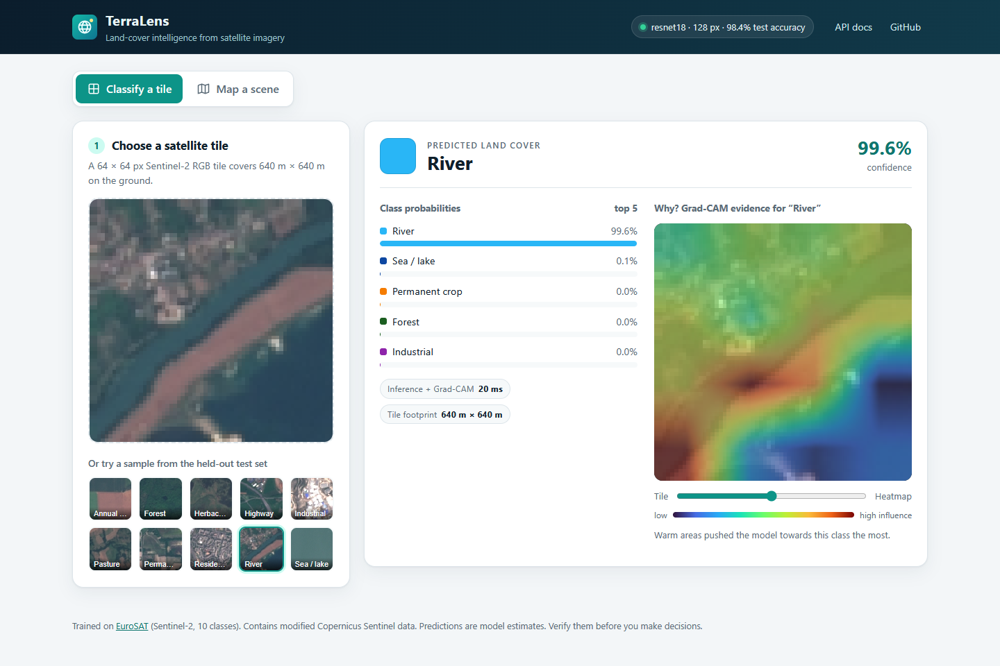 | 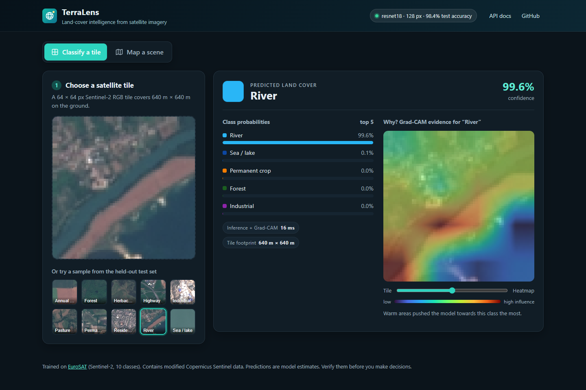 |

| Land-cover layer of the Lake Constance scene | Interactive API documentation |
|---|---|
| 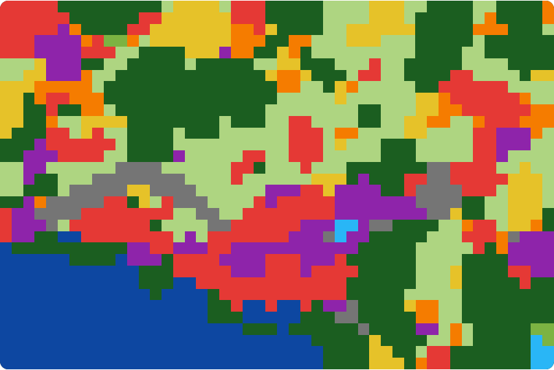 | 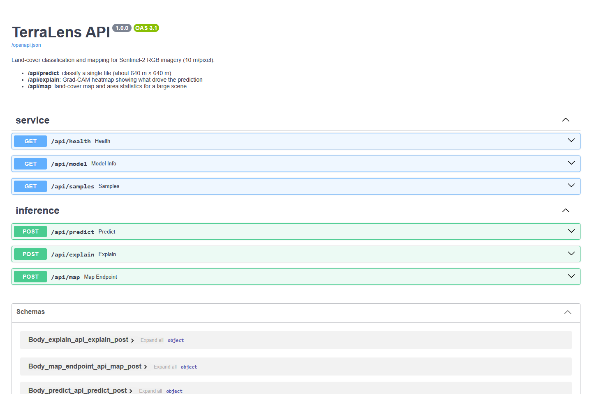 |

## Results

| Deployed model: ResNet18 @ 128 px | |
|---|---:|
| EuroSAT test accuracy (4,050 held-out tiles) | **98.42%** (macro F1 0.983) |
| Expected calibration error, before → after temperature scaling | 0.086 → **0.005** |
| Accuracy on tiles re-compressed as JPEG q75 / q50 | **97.98% / 96.99%** |
| Mapping accuracy on a mosaic of 216 held-out tiles with known layout | **97.7%** |
| Agreement with ESA WorldCover on real scenes, homogeneous tiles (2 sites) | **83.0%** |

### 1. The benchmark winner is not the real-world winner

Six backbones were fine-tuned with the same recipe (12 epochs, AdamW + OneCycle, label smoothing 0.1, mixed precision), scored on the held-out EuroSAT test split, and then **run on two real Sentinel-2 scenes** (Lake Constance, Germany, and Mantua, Italy). Each map was compared with ESA WorldCover on tiles where one land-cover class clearly dominates.

| Backbone | Input | Params | CPU latency* | EuroSAT test acc. | Real-world agreement |
|---|---:|---:|---:|---:|---:|
| ResNet50 | 128 px | 23.5 M | 16.9 ms | **99.01%** | 77.5% |
| ResNet18 | 224 px | 11.2 M | 19.9 ms | 98.84% | **86.3%** |
| EfficientNet-B0 | 128 px | 4.0 M | 8.7 ms | 98.81% | 69.2% |
| MobileNetV3-Large | 128 px | 4.2 M | **5.2 ms** | 98.81% | 73.6% |
| ResNet18 | 128 px | 11.2 M | 8.1 ms | 98.62% | 81.3% |
| ResNet18 | 64 px | 11.2 M | 3.6 ms | 98.20% | 76.9% |

<sub>*Median for one image on an Intel Core i5-12400F, which is how the Docker image runs. Real-world agreement: homogeneous tiles pooled over both scenes (182 tiles).</sub>

The benchmark spread is 0.8 points; the real-world spread is 17. **ResNet50 tops EuroSAT but transfers worse than ResNet18.** MobileNetV3 agreed with WorldCover on 98.9% of Lake Constance's homogeneous tiles but only 46.6% at Mantua, so a single validation scene would have picked the wrong model.

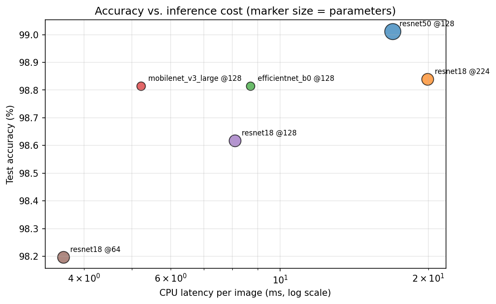

### 2. Robustness to JPEG compression

Users upload JPEG exports and screenshots. Re-compressing test tiles exposed a large weakness, so training now re-encodes tiles at a random JPEG quality ([#23](https://github.com/Med00amine/TerraLens/issues/23)):

| Model | Clean | JPEG q95 | JPEG q75 | JPEG q50 |
|---|---:|---:|---:|---:|
| ResNet18 @ 128 | 98.62% | 97.41% | 85.38% | 72.22% |
| ResNet18 @ 224 | 98.84% | 96.77% | 76.84% | 65.56% |
| MobileNetV3 @ 128 | 98.81% | 96.86% | 78.35% | 68.20% |
| **ResNet18 @ 128 + JPEG augmentation (deployed)** | 98.42% | **98.52%** | **97.98%** | **96.99%** |

**Model selection rule:** among models that keep ≥ 98.3% EuroSAT accuracy and ≥ 95% accuracy at JPEG q50, pick the one with the best real-world agreement. That is ResNet18 @ 128 with JPEG augmentation, which also has the best all-tile agreement of every model tried (57.7%).

<details>
<summary>Augmented candidates compared</summary>

| Candidate | Lake Constance | Mantua | Pooled (homogeneous) | Pooled (all tiles) | JPEG q50 |
|---|---:|---:|---:|---:|---:|
| **ResNet18 @ 128 + JPEG (q50–95)** | 90.4% | 75.0% | **83.0%** | **57.7%** | 96.99% |
| ResNet18 @ 224 + JPEG (q75–95) | 78.7% | 79.5% | 79.1% | 55.5% | 95.11% |
| MobileNetV3 @ 128 + JPEG (q50–95, 20 epochs) | 75.5% | 67.0% | 71.4% | 50.1% | 97.43% |
| MobileNetV3 @ 128 + JPEG (q75–95) | 77.7% | 45.5% | 62.1% | 44.4% | 96.20% |

JPEG augmentation helped ResNet18 but hurt MobileNetV3's transfer to real scenes, even in a milder form.
</details>

### 3. External validation on real scenes

| Lake Constance, Germany (forest, orchards, town, lake) |
|---|
| 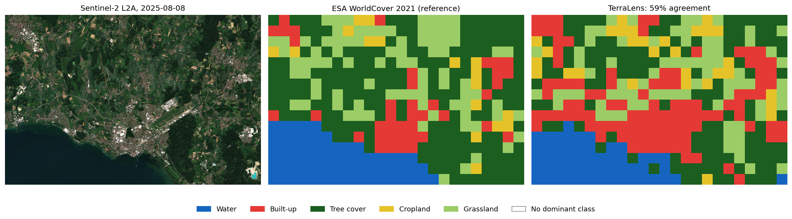 |

| Mantua, Italy (cropland, lakes, historic city) |
|---|
| 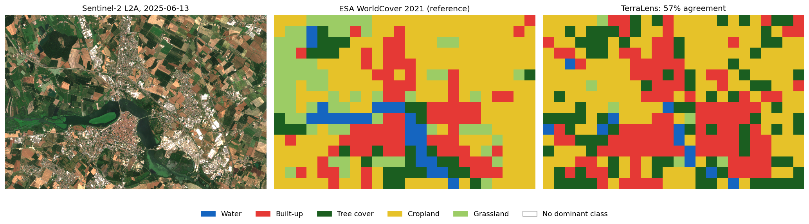 |

| Scene | Homogeneous tiles (≥ 80% one class) | All tiles |
|---|---:|---:|
| Lake Constance | **90.4%** (κ 0.82) | 58.6% (κ 0.45) |
| Mantua | **75.0%** (κ 0.47) | 56.8% (κ 0.39) |

Where the maps disagree, the cause is usually definitions rather than errors:

- **Mixed tiles.** A 640 m tile containing a village in farmland is reasonably *Residential* for TerraLens, while WorldCover counts its pixels as mostly vegetation.
- **Single date vs. a full year.** In one June image, a young crop field, a pasture and an orchard look alike; WorldCover separates them using a year of observations.
- **Genuine failure modes.** Lake Constance's hail-net orchards look like grey industrial roofs at 10 m, and Mantua's algae-covered lakes look like vegetation.

WorldCover is itself a model (~77% accuracy reported by ESA), so these are agreement scores, not ground truth.

### 4. Explanations and errors

Grad-CAM for one random test tile per class: the model attends to the road, the buildings, the river channel and the orchard rows.

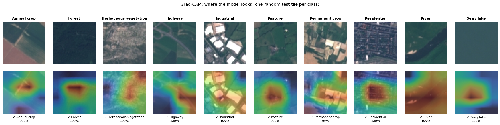

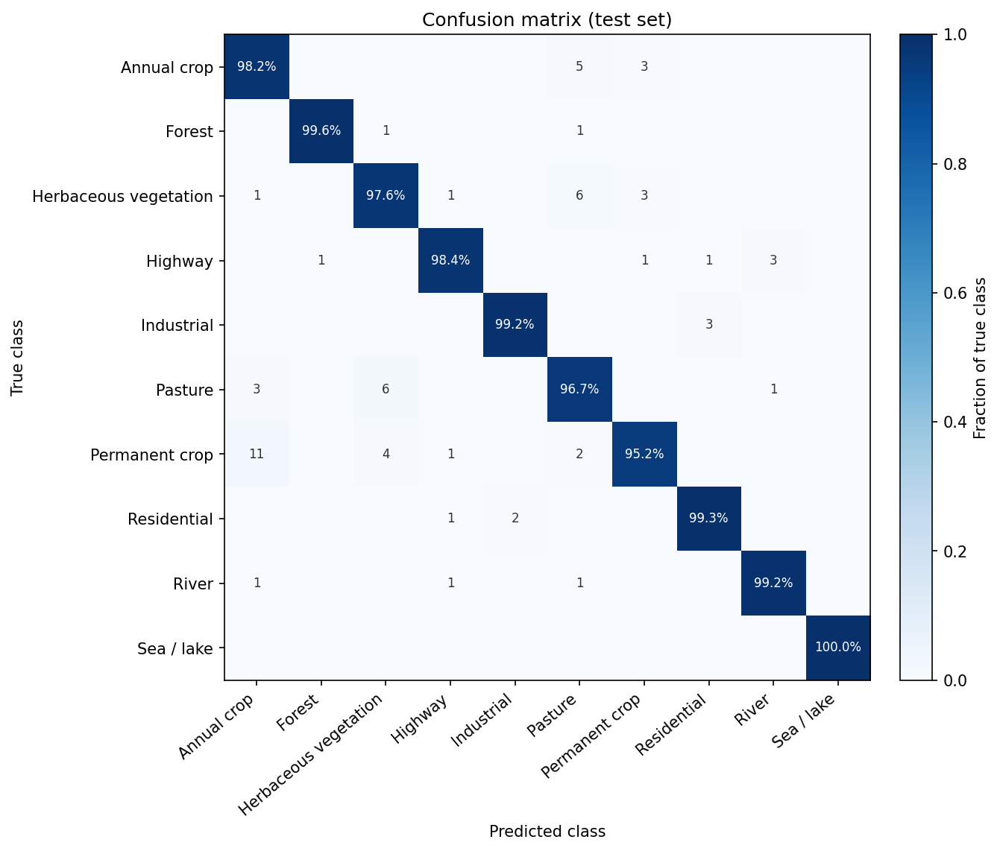 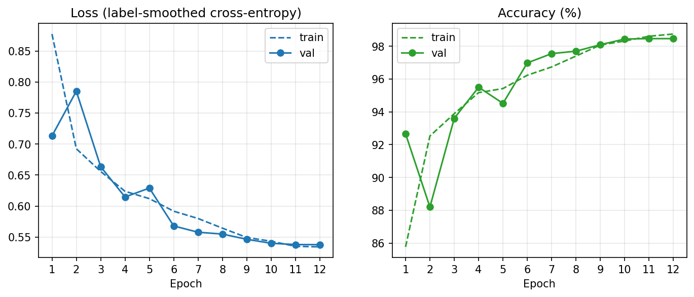

Remaining errors are mostly between vegetation classes that genuinely look alike at 10 m. Some are arguably label ambiguity, such as a river tile crossed by a road bridge or a highway beside an industrial zone:

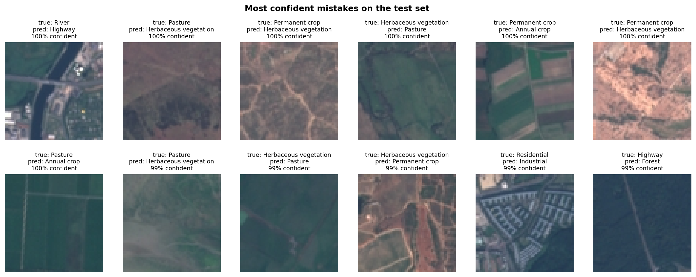

### 5. What didn't work

- **Radiometric augmentation** ([#19](https://github.com/Med00amine/TerraLens/issues/19)). EuroSAT is top-of-atmosphere (L1C) data, while most downloads are atmospherically corrected (L2A) and look darker. Simulating that colour shift *lowered* real-scene agreement (92.6% → 71.3% on homogeneous tiles) by making dark forest ambiguous. It stays off (`--radiometric-aug`).
- **Trusting one validation scene.** It ranked MobileNetV3 first; a second site ranked it near the bottom. Model choice now uses both sites.
- **Calibrating with label smoothing alone.** Label smoothing capped confidence at ~91% (ECE 0.086); temperature scaling fixed it without changing any prediction.

## How it works

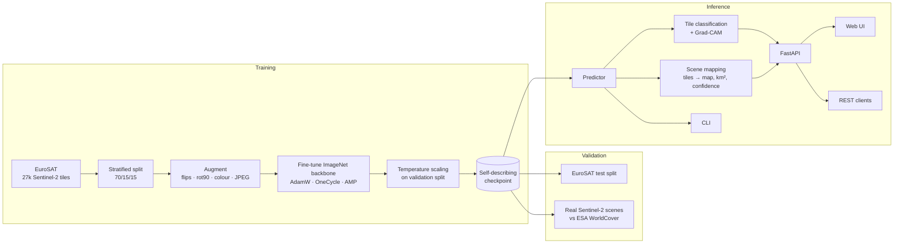

- **Checkpoints describe themselves:** architecture, classes, input size, normalisation, temperature, metrics and the full training config travel with the weights, so inference needs nothing else, and evaluation can rebuild the exact held-out test split.
- **Mapping** cuts the scene into 64 px tiles straight from a strided `uint8` view, classifies them in batches, and with `stride < tile` averages overlapping predictions onto a finer grid. Areas are weighted by real pixel coverage at the scene edges.
- **The API** validates uploads (type, size, pixel count, decompression bombs, truncated files), runs inference off the event loop, warms the model up at start, and degrades gracefully (HTTP 503) when no model is present.

## Quickstart

### Docker (recommended)

```bash
docker build -t terralens .            # downloads the released weights (checksum-verified)
docker run -p 8000:8000 terralens      # open http://localhost:8000
```

### Local install

```bash
git clone https://github.com/Med00amine/TerraLens.git && cd TerraLens
pip install -e ".[dev]"                # Python 3.10+
terralens download-model               # fetch the v1.0.0 weights
terralens serve                        # http://127.0.0.1:8000, API docs at /docs
```

### Command line

```bash
terralens predict tile.jpg --explain-dir out/      # classes + Grad-CAM overlay
terralens map scene.png --stride 32 --out-dir maps # map, overlay, confidence, stats.json
```

```text
$ terralens map lake_constance.png --stride 32
1457 tiles, 157.3 km2, 0.49s
  Forest                    28.3%     44.54 km2
  Pasture                   18.9%     29.80 km2
  Residential               15.6%     24.47 km2
  Sea / lake                13.2%     20.79 km2
  Industrial                 7.8%     12.29 km2
  ...
```

### REST API

```bash
curl -F "file=@tile.png" "http://localhost:8000/api/predict?top_k=3"
curl -F "file=@scene.png" "http://localhost:8000/api/map?stride_px=32"
```

| Endpoint | Purpose |
|---|---|
| `POST /api/predict` | ranked classes for one tile |
| `POST /api/explain` | Grad-CAM overlay for the top (or a chosen) class |
| `POST /api/map` | land-cover map, overlay, confidence map and per-class areas |
| `GET /api/model` | model card: architecture, classes, metrics, temperature |
| `GET /api/health` | liveness and model status |

## Train your own model

```bash
terralens train --model resnet18 --img-size 128          # EuroSAT downloads automatically
terralens evaluate runs/resnet18-128/model.pt            # report + figures
terralens evaluate --compare runs/*/model.pt             # accuracy vs latency table
```

Use your own classes with any folder of images per class: `terralens train --dataset folder --data-root my_tiles/`. Backbones: `resnet18`, `resnet50`, `efficientnet_b0`, `mobilenet_v3_large`, `convnext_tiny`.

Every number and figure here can be regenerated: `scripts/run_experiments.sh` (backbone comparison), `scripts/robustness.py`, `scripts/fetch_sentinel2_scene.py` + `scripts/compare_worldcover.py` (external validation), `scripts/make_figures.py` and `scripts/take_screenshots.py`. Raw results are in [`docs/results/`](docs/results).

## Project structure

```text
src/terralens/
├── data.py          # EuroSAT / ImageFolder loading, stratified splits, augmentations
├── models.py        # backbone zoo with resized heads, Grad-CAM target layers
├── train.py         # training loop: AMP, OneCycle, early stopping, calibration
├── calibration.py   # temperature scaling and expected calibration error
├── evaluate.py      # metrics, reports, model comparison, CPU latency
├── explain.py       # Grad-CAM and heatmap overlays
├── predictor.py     # inference wrapper used by the CLI and API
├── mapping.py       # large-scene tiling, map assembly, area statistics
├── download.py      # checksum-verified model download
├── api/             # FastAPI app, schemas, web UI (static/)
└── cli.py           # `terralens` command
scripts/             # experiments, validation, figures, screenshots
docs/results/        # raw results behind every table in this README
tests/               # pytest suite (no dataset download needed)
```

## Development

```bash
pip install -e ".[dev]"
pytest                    # 100+ tests, ~15 s on CPU
ruff check . && ruff format --check .
```

CI runs lint, the test suite on Python 3.11 and 3.12 with CPU-only PyTorch, and builds and smoke-tests the Docker image on every push and pull request.

## Limitations

TerraLens labels 640 m × 640 m tiles, so mixed tiles get a single label; it uses a single date, so crops, pastures and orchards can be confused; and it was trained on European imagery with 10 classes (no snow, desert or tropical forest). Predictions are estimates to explore and prioritise, not an authoritative map. See the **[model card](MODEL_CARD.md)** for intended use, evaluation and known failure modes.

## Roadmap

- Pixel-level segmentation for mixed tiles
- Multi-date input to separate crops, pastures and orchards
- Multispectral input (all 13 Sentinel-2 bands) and fine-tuning on L2A imagery
- More validation sites outside Europe
- GeoTIFF input and output with coordinates

## Background

This repository started in 2025 as my collection of PyTorch exercise notebooks (custom datasets, transfer learning, computer vision). TerraLens grew out of them into a complete, tested and deployable tool.

## Acknowledgements and data

- **EuroSAT:** Helber, P., Bischke, B., Dengel, A., Borth, D. *EuroSAT: A Novel Dataset and Deep Learning Benchmark for Land Use and Land Cover Classification.* IEEE JSTARS, 2019.
- **Sentinel-2 imagery:** contains modified Copernicus Sentinel data 2025, accessed through the [Earth Search](https://earth-search.aws.element84.com/v1) STAC catalogue (AWS Open Data).
- **ESA WorldCover:** © ESA WorldCover project 2021 / Contains modified Copernicus Sentinel data (2021) processed by the ESA WorldCover consortium, CC BY 4.0.
- **Grad-CAM:** Selvaraju et al., ICCV 2017. **Temperature scaling:** Guo et al., ICML 2017.

## License

[MIT](LICENSE) © 2026 Mohamed Amine Bouzoffara
